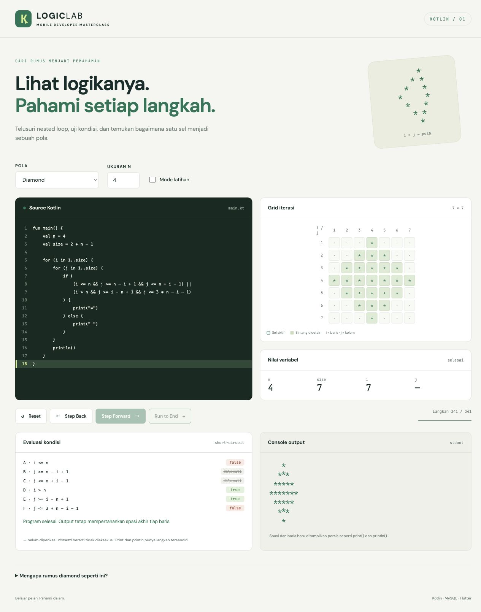

# Mobile Developer Technical Test Masterclass

Repository belajar mandiri **Kotlin Logic, MySQL, dan Flutter CRUD** dalam Bahasa Indonesia. Kamu dapat menelusuri nested loop lewat debugger visual, mengerjakan soal dengan jawaban terpisah, serta menjalankan aplikasi inventaris yang menyimpan data melalui REST API ke MySQL.



## Mulai dari sini

- Belum memasang tools? Ikuti [instalasi Windows11, macOS Apple Silicon, Ubuntu](docs/01-install-tools.md), [Android Studio](docs/02-setup-android-studio.md), dan [Flutter](docs/03-setup-flutter.md).
- Ingin langsung menjalankan semua? Buka [tutorial dari clone sampai CRUD di emulator](docs/07-running-full-project.md).
- Ingin belajar logika dahulu? Buka [Kotlin](kotlin-logic/README.md) dan `simulator/index.html`.
- Cari bukti pengujian? Baca [laporan verifikasi](docs/12-laporan-verifikasi.md). Hasil lokal dan pemeriksaan CI yang belum dieksekusi dibedakan.

## Tujuan dan isi

| Jalur       | Yang dipelajari                                                       | Praktik                                                                                         |
| ----------- | --------------------------------------------------------------------- | ----------------------------------------------------------------------------------------------- |
| A · Kotlin  | Variabel, loop, Boolean, array/string, algoritma                      | 12 pola, 13 algoritma utama, 30 latihan, trace 49 sel diamond                                   |
| B · MySQL   | DDL/DML, key/normalisasi, JOIN, agregat, CTE/window, indeks/transaksi | 7 tabel berelasi, seed deterministik, 35 soal + expected result + solusi terpisah               |
| C · Flutter | UI/state/repository/data source, REST, validasi/error handling        | List/detail/create/edit/delete, search/filter/pagination, refresh, unit/widget/integration test |
| Logic Lab   | Debugging visual dan short circuit                                    | 4 pola, Step Forward/Back, Reset, Run to End, mode latihan, responsif                           |

## Prasyarat dan stack

Baseline: Git, JDK17, Kotlin2.1.20, Node24 LTS, MySQL8.4 (atau Docker), Flutter3.29.0/Dart3.7.0, Android SDK35/emulator. Flutter baseline adalah versi stable yang tersedia saat pengerjaan, bukan klaim rilis terbaru. Riverpod2.6.1, Dio5.8.0+1, go_router14.8.1 dikunci untuk kompatibilitas; backend memakai TypeScript strict, Express5, mysql2/promise, Zod4. Lihat [versi/sumber resmi](docs/11-versi-dan-referensi.md).

## Struktur repository

```text
docs/                  Panduan instalasi, roadmap, tutorial, troubleshooting, ujian
kotlin-logic/          basics, patterns, algorithms, exercises, solutions, tests
mysql-masterclass/     schema, seed, queries, exercises, solutions, tests, reset
backend/               src route/controller/service/repository, tests, Dockerfile
flutter-crud/          lib feature-first, test, integration_test, platform android
simulator/             index.html, style.css, engine.js, app.js, tests
scripts/               Runner Kotlin, pemeriksaan link, pengemasan ZIP
.github/workflows/     CI Kotlin, backend/MySQL, Flutter Android, simulator, Pages
```

`simulator/engine.js` dipisah dari UI agar evaluasi short-circuit dapat diuji tanpa browser; `scripts/` menyatukan perintah bantu. Android platform benar-benar dihasilkan Flutter, bukan placeholder. [Arsitektur dan keamanan](docs/13-arsitektur-dan-keamanan.md) menjelaskan keputusan dan batasannya.

## Quick start

```bash
git clone https://github.com/Samsul-Arip/doc.git mobile-developer-technical-test-masterclass
cd mobile-developer-technical-test-masterclass
cp .env.example .env
```

**Edit dua password placeholder dalam .env** sebelum langkah berikut. Docker Desktop/Engine harus aktif:

```bash
docker compose up -d --build
curl http://localhost:3000/ready
cd flutter-crud
flutter pub get
flutter devices
flutter run -d <DEVICE_ID> --dart-define=API_BASE_URL=http://10.0.2.2:3000/api
```

Ganti DEVICE_ID dengan id emulator Android aktif, bukan teks placeholder. Buat/start AVD dahulu sesuai [panduan emulator](docs/06-running-emulator.md). Windows PowerShell: pakai Copy-Item, curl.exe; import SQL memakai SOURCE atau Git Bash. Jalur tanpa Docker dijelaskan lengkap pada [setup MySQL](docs/04-setup-mysql.md) dan [backend](docs/05-setup-backend.md).

## Menjalankan tiap modul

Dari root: `bash scripts/kotlin.sh diamond 4`, `bash scripts/kotlin.sh algorithms`, `bash scripts/kotlin.sh test`. Compiler kotlinc/JDK harus ada di PATH. Materi diamond mempertahankan rumus conditional gabungan tanpa abs().

Database: import `schema/00-database.sql`, `schema/01-tables.sql`, lalu `seed/02-seed.sql` memakai MySQL CLI. Lihat [35 soal](mysql-masterclass/exercises/35-soal.md) sebelum membuka solutions. Reset eksplisit menghapus tabel latihan; jangan gunakan database kerja.

Backend: dari `backend`, salin .env.example ke .env, isi koneksi lokal, `npm ci`, `npm run dev`. Uji `/health`, `/ready`, `/api/products`, `/api/categories`. Query list mendukung page/limit/search/categoryId.

Flutter: dari `flutter-crud`, `flutter analyze`, `flutter test`, dan `flutter build apk --debug`. Integration test memerlukan API/MySQL serta emulator; perintah lengkap ada di [README aplikasi](flutter-crud/README.md).

Simulator: buka `simulator/index.html` langsung, atau `python3 -m http.server 8080 --directory simulator`, lalu http://localhost:8080. Tidak memerlukan backend. GitHub Pages sudah disiapkan melalui workflow; [publikasi manual](docs/09-git-github-guide.md) menjelaskan repo public dan aktivasi Pages.

## Roadmap 7 hari

1. Instalasi dan dasar Kotlin.
2. Nested loop, 12 pola, trace diamond di Logic Lab.
3. Algoritma, edge case, dan kompleksitas.
4. SQL fundamental, relasi, JOIN/agregasi.
5. SQL lanjut dan REST API MySQL.
6. Flutter CRUD pada emulator dan test.
7. [Simulasi technical test 120 menit + rubrik](docs/10-technical-test-tips.md).

[Roadmap rinci](docs/00-roadmap-belajar.md) memberi target harian. Checklist kesiapan: bisa menjelaskan rumus, menangani NULL/overflow, menguji CRUD persisten, membaca error, menjalankan checks, dan memastikan source bebas rahasia.

## Pemeriksaan kualitas

```bash
npm ci --prefix backend
npm run format:check --prefix backend
npm run lint --prefix backend
npm test --prefix backend
npm run build --prefix backend
node --test simulator/tests/*.test.cjs
bash scripts/kotlin.sh test
python3 scripts/check_links.py
```

Flutter diperiksa dari foldernya (`dart format --output=none --set-exit-if-changed lib test integration_test`, `flutter analyze`, `flutter test`). CI juga menyediakan MySQL8.4 service, verifikasi 35 hasil query, tes HTTP DB nyata, serta build APK debug. Workflow Pages hanya mengunggah simulator. CI perlu push ke GitHub untuk benar-benar dieksekusi.

## Bantuan dan kontribusi

[Daftar troubleshooting](docs/08-troubleshooting.md) mencakup PATH/SDK, Gradle/JDK, perangkat, MySQL access denied, HTTP400/404/500, dan jaringan emulator. Android Emulator standar memakai 10.0.2.2 untuk host; Android fisik memakai IP LAN atau adb reverse.

Kontribusi: buat branch, pertahankan penjelasan Bahasa Indonesia, tambahkan contoh/edge case, jalankan pemeriksaan terkait, lalu buka PR dengan bukti hasilnya. [Panduan Git/GitHub](docs/09-git-github-guide.md) menjelaskan langkah dari nol. Lisensi [MIT](LICENSE).
