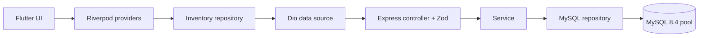

# Alur data, keputusan arsitektur, dan batas penggunaan

Pemisahan repository memungkinkan unit/widget test tanpa server; integrasi database memakai repository MySQL yang sama dengan runtime. Tidak ada clean architecture berlapis-lapis yang hanya meneruskan satu panggilan tanpa manfaat belajar. Route/controller/service/repository backend tetap dipisah karena itulah tanggung jawab yang ingin dipelajari.

**Integritas:** SKU unik ditegakkan MySQL sehingga dua request serentak tetap tidak bisa membuat SKU ganda. Foreign key memastikan kategori ada dan menjaga histori order. Stok/harga tidak negatif pada Zod dan CHECK database. Harga pesanan disimpan terpisah dari katalog. Endpoint update adalah last-write-wins; latihan belum memiliki optimistic locking/versioning. Count dan data pagination adalah dua query sehingga bisa berbeda sesaat saat ada penulis serentak; untuk snapshot kuat gunakan transaksi sesuai isolasi yang dipilih.

**Lingkungan development:** API HTTP lokal, CORS whitelist opsional, konfigurasi debug Flutter mengizinkan cleartext, akun DB DML dengan password lokal. Docker mengekspose MySQL hanya ke 127.0.0.1 dan API port untuk akses emulator/LAN. Server tidak mencetak password atau SQL error ke klien. Tidak ada credential di Dart atau source Git.

**Sebelum deployment produksi:** proyek ini adalah latihan tanpa login/otorisasi. Gunakan HTTPS valid, autentikasi dan otorisasi per operasi, rate limiting, pengelolaan rahasia, backup/migrasi, audit log yang sesuai data, pembatasan jaringan, observabilitas, serta signing Android sendiri. Jangan mempublikasikan API latihan terbuka ke internet hanya karena simulator aman dipublikasi; Pages hanya menampung aset statis simulator. .env.example bukan tempat rahasia asli.

**Query:** semua nilai request menjadi parameter prepared/escaped, tidak digabung ke SQL. Fragmen kolom/WHERE statis milik aplikasi. Search memakai LOCATE agar `%`/`_` literal, tetapi scan substring punya biaya; materi EXPLAIN menjelaskan kapan full-text layak. `price` memakai DECIMAL di MySQL, JSON number di API, batas dua desimal; aplikasi akuntansi produksi sebaiknya mempertahankan integer minor unit/decimal end-to-end.

**Pengujian:** fake repository menguji kontrak HTTP; tes MySQL memastikan SQL/relasi/error DB nyata; Flutter decoder/repository/widget memeriksa perilaku UI; integration_test menguji koneksi perangkat ke backend. CI tidak menggantikan semua OS/perangkat; lihat laporan bukti aktual.
