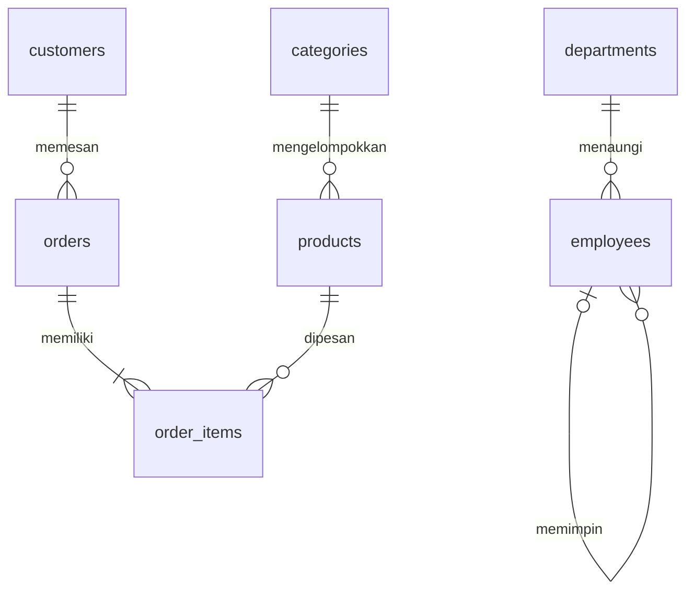

# MySQL Masterclass

Target MySQL **8.4 LTS**, SQL juga memakai fitur MySQL 8.0.16+ (CHECK benar-benar ditegakkan). Baca [setup](../docs/04-setup-mysql.md), lalu kerjakan [35 soal dengan expected result](exercises/35-soal.md). Jawaban tersimpan terpisah di `solutions/01.sql` sampai `35.sql`. Fixture hasil dapat diuji ulang dengan `node mysql-masterclass/tests/verify.mjs` setelah `npm ci --prefix backend` dan variabel DB diatur.

## Urutan belajar

1. **Database dan tabel.** Database menampung tabel; baris adalah satu entitas, kolom adalah atribut. `INT` cocok untuk id/stok, `VARCHAR` untuk teks terbatas, `DECIMAL` untuk uang, `DATETIME` untuk UTC. FLOAT berpotensi memberi galat pembulatan uang. `NULL` berbeda dari string kosong dan angka nol.
2. **Kunci dan relasi.** Primary key unik dan tidak NULL. Foreign key memastikan referensi ada; penghapusan produk yang pernah dipesan ditolak, sehingga riwayat transaksi tetap valid. `employees.manager_id` merujuk pegawai sendiri. Departemen Support dan kategori Furniture sengaja kosong untuk melatih outer join.
3. **Normalisasi.** 1NF: setiap sel satu nilai, jangan simpan daftar produk dipisah koma. 2NF: atribut bergantung pada seluruh kunci; quantity milik pasangan order/produk. 3NF: nama kategori berada di categories, tidak diulang pada setiap produk. `unit_price` adalah snapshot historis, sehingga tetap perlu walau products punya price.
4. **DDL.** CREATE membuat, ALTER mengubah struktur, DROP menghapus struktur beserta isinya. DDL umumnya implicit commit; ROLLBACK tidak membatalkannya. Pelajari contoh tabel sementara di `queries/01-fundamental.sql`.
5. **DML.** INSERT menambah, UPDATE mengubah, DELETE menghapus. Selalu tulis WHERE dan coba SELECT dengan predikat yang sama dahulu. Jalankan latihan perubahan dalam transaksi dan ROLLBACK.
6. **SELECT.** Urutan pikir: FROM/JOIN → WHERE → GROUP BY → HAVING → SELECT → DISTINCT → ORDER BY → LIMIT. Ini urutan logis, bukan janji rencana eksekusi fisik optimizer.
7. **Predikat.** `LIKE '%o%'` mencari substring, `IN` mencocokkan daftar, `BETWEEN` inklusif, `IS NULL` memeriksa data tidak diketahui. AND lebih kuat dari OR; gunakan kurung untuk menegaskan niat. SQL punya logika tiga nilai: true, false, unknown.
8. **JOIN.** INNER hanya pasangan cocok, LEFT mempertahankan kiri, RIGHT mempertahankan kanan. SELF JOIN memakai dua alias tabel yang sama. Hindari join tanpa ON karena bisa menjadi perkalian kartesius. Satu pelanggan dengan banyak order akan muncul berulang; tentukan grain hasil sebelum agregasi.
9. **UNION.** Jumlah/tipe kolom kedua query harus cocok. UNION menghapus duplikasi seluruh baris; UNION ALL mempertahankannya dan biasanya mengurangi pekerjaan deduplikasi.
10. **Agregasi.** COUNT(*) menghitung baris, COUNT(kolom) hanya non-NULL. SUM/AVG/MIN/MAX mengabaikan NULL; SUM tanpa baris menghasilkan NULL. COALESCE mengubah NULL menjadi nol jika itu makna bisnisnya. WHERE menyaring baris, HAVING menyaring kelompok. Jangan mematikan ONLY_FULL_GROUP_BY untuk membenarkan query ambigu.
11. **Subquery/CASE/EXISTS.** Subquery skalar harus menghasilkan paling banyak satu baris. Subquery terkorelasi merujuk baris luar. EXISTS cocok untuk keberadaan tanpa duplikasi; NOT EXISTS menghindari jebakan NULL pada NOT IN. CASE memilih label/rumus sesuai kondisi.
12. **CTE dan window.** WITH menamai hasil antara. GROUP BY mengurangi jumlah baris; window mempertahankan baris. ROW_NUMBER memberi nomor unik, RANK melompat setelah seri, DENSE_RANK tidak. PARTITION BY memulai ulang per kelompok; ORDER BY dalam OVER mengatur perhitungan, bukan urutan hasil akhir. Frame ROWS eksplisit penting bagi running total.
13. **Indeks.** B-tree membantu filter kesetaraan/rentang dan pengurutan yang sesuai prefix. Indeks `(category_id,id)` berguna untuk filter kategori + urutan id. Leading wildcard dan LOCATE tidak memakai indeks nama secara efisien. Untuk data besar pertimbangkan full-text sesuai kebutuhan. Indeks menambah ruang dan biaya tulis; jangan mengindeks setiap kolom tanpa pengukuran.
14. **Transaksi.** ACID: atomik, konsisten, terisolasi, tahan lama. Gunakan transaksi untuk banyak perubahan yang harus berhasil bersama. SELECT FOR UPDATE mengunci baris sampai COMMIT/ROLLBACK. Urutan lock konsisten mengurangi deadlock; aplikasi perlu strategi retry terbatas untuk deadlock nyata.
15. **Optimasi.** Gunakan EXPLAIN untuk key, type, rows, Extra. ALL pada seed delapan produk bukan otomatis masalah: optimizer bisa memilih scan karena murah. EXPLAIN ANALYZE menunjukkan waktu/baris aktual. Hindari SELECT *, N+1, fungsi pada kolom terindeks, serta OFFSET sangat besar. Ukur dengan dataset representatif sebelum menambah indeks.

## Relasi

Seed deterministik: 4 departments, 6 employees, 4 categories, 8 products, 5 customers, 6 orders, 10 order_items. Ada gaji seri, nomor telepon NULL, stok nol, kategori kosong, pelanggan tanpa order, dan produk belum dipesan.

## Reset

Dari root repository: `mysql -u root -p < mysql-masterclass/reset.sql`. Perintah ini menghapus seluruh tabel latihan dalam **masterclass**. SOURCE memakai path relatif root. Hindari menjalankan API atau latihan modifikasi saat memverifikasi expected result; hasil fixture mengasumsikan seed asli. Volume Docker yang sudah terisi tidak menjalankan init SQL lagi; lihat panduan reset pada dokumentasi database.

Referensi: [manual MySQL 8.4](https://dev.mysql.com/doc/refman/8.4/en/), [window functions](https://dev.mysql.com/doc/refman/8.4/en/window-functions.html), [EXPLAIN](https://dev.mysql.com/doc/refman/8.4/en/explain.html).
